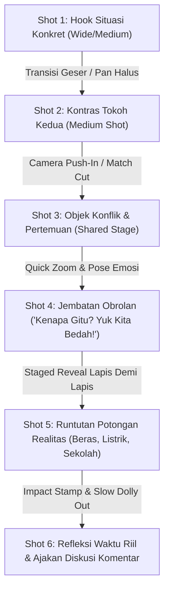

# Bedah Pola World-Building, Kamera Sinematik, & Storytelling 2D (Sample Analysis)

Dokumen ini merangkum hasil ekstraksi menyeluruh dari seluruh video sampel di folder `sample/2d/` (`akaldanotak`, `logikabayi`, `scandulu.id`, `daristeppe`, `undonesia.id`, `nirmalaprojectid`, `titikmind`, dll.). Analisis mencakup urutan *shot-by-shot*, pembentukan dunia visual berlapis (*layered world-building*), koreografi kamera, alur emosi naskah, dan perlakuan teks layar.

---

## 1. Konsep "World" (Dunia Visual Berlapis, Bukan Kotak Kosong)

Dalam video sampel 2D viral, karakter **tidak pernah diletakkan di dalam kotak diagram terisolasi atau di atas latar belakang kosong**. Karakter selalu hidup di dalam ekosistem dunianya:

| Lapisan Elemen | Karakter Pedesaan / Buruh (Pak Budi) | Karakter Urban / Bisnis (Pak Anu) | Area Penjelasan / Showcase |
| :--- | :--- | :--- | :--- |
| **Latar Jauh (Sky & Atmosphere)** | Gradasi fajar hangat (#FDE68A ke #0F172A), matahari terbit lembut dengan bias sinar (sun rays), awan tipis melayang. | Gradasi twilight dingin (#0284C7 ke #0B1120), siluet gedung pencakar langit dengan titik lampu jendela menyala. | Konus sorot lampu panggung (*spotlight cone*), partikel debu cahaya melayang (*atmospheric dust*). |
| **Latar Tengah (Midground Context)** | Pematang sawah terasering berundak, gubuk bambu kecil di kejauhan, pepohonan kelapa / sengon. | Jendela kaca kantor modern, meja kerja eksekutif, laptop tipis dengan layar chart menyala, cangkir kopi. | Etalase kaca ritel mewah dengan refleksi lantai glossy (*floor reflection*), partikel kilau. |
| **Objek Utama (Hero Characters & Props)** | Karakter 2D proporsional (tinggi ~340–420px), caping bambu bertekstur, kemeja kerja petani, cangkul/towel di leher. | Karakter 2D proporsional, setelan jas navy, dasi merah, kacamata berbingkai tipis, tas kerja (*briefcase*). | Unit iPhone 15 dengan casing titanium realistis, bayangan jatuh dramatis, kartu harga bersih tanpa teks mikro. |
| **Latar Depan (Foreground Framing)** | Rumpun batang padi melengkung di tepi bawah, pagar kayu desa tipis yang memberi kedalaman ruang (*depth of field*). | Sudut meja kantor atau siluet tanaman hias monstera di pojok bawah. | Batas etalase minimalis atau tepian konter ritel premium. |

---

## 2. Urutan Shot & Transisi Cerita (End-to-End Shot Progression)

Berdasarkan bedah frame penuh pada `akaldanotak` dan `logikabayi`:

1. **Shot 1 (Hook Tokoh 1)**: Membuka dengan panggung penuh tokoh pertama di dunianya. Penonton langsung terhubung dengan profesi dan kehidupannya tanpa terdistraksi angka-angka rumit.
2. **Shot 2 (Kontras Tokoh 2)**: Kamera bergeser mulus (*gentle pan*) memperkenalkan tokoh pembanding di dunianya yang sangat bertolak belakang (desa vs kota, upah harian vs omzet bisnis).
3. **Shot 3 (Objek Konflik)**: Menyatukan kedua tokoh di satu etalase bersama. Kamera melakukan *slow dolly-in* ke objek yang sama persis (iPhone 15 dengan harga sama), mempertegas premis utama.
4. **Shot 4 (Jembatan Obrolan Alami)**: Sebelum masuk ke hitungan angka, karakter bereaksi manusiawi (Pak Budi bingung garuk kepala dengan tetesan keringat, Pak Anu tersenyum santai). Diikuti tombol ajakan obrolan ramah: *"Kenapa gitu? Yuk sini kita jelasin!"*.
5. **Shot 5 (Simulasi Bertahap / Non-Dashboard)**: Tidak menumpuk tabel statistik. Pengeluaran dimunculkan satu per satu seperti mengeluarkan barang dari keranjang belanja nyata (beras $\rightarrow$ listrik $\rightarrow$ uang sekolah $\rightarrow$ sisa dompet tipis).
6. **Shot 6 (Refleksi Hangat & Closing)**: Cap stempel kalkulasi dramatis (Hampir 7 Tahun) disusul pertanyaan empati yang memicu diskusi di kolom komentar.

---

## 3. Koreografi Kamera Sinematik (Frame-Based Remotion Motion)

- **Slow Dolly-In (0.0% $\rightarrow$ 5.0% scale)**: Selama tokoh berbicara, kamera bergerak maju perlahan (`interpolate(frame, [0, duration], [1.0, 1.05], { extrapolateRight: "clamp" })`) untuk mempertahankan ketegangan visual.
- **Gentle Pan ($X$-axis)**: Perpindahan antar-lingkungan menggunakan kurva *cubic-bezier* ease-out (`spring({ damping: 14, stiffness: 90 })`), bukan cut instan yang kasar.
- **Secondary Motion Karakter**:
  - Napas berirama: `translateY(Math.sin(frame / 12) * 4px)`
  - Anggukan kepala halus: `rotate(Math.sin(frame / 9) * 2.5deg)`
  - Kedipan mata acak alami: `frame % 80 < 5`
  - Efek emosi situasional: Tetesan keringat berdenyut pada saat bingung, mulut membuka-tutup mengikuti audio (`talking`).

---

## 4. Hirarki Teks & Safe Zone (Bebas Teks Mikro)

- **Kartu Atas (Top Safe Area 0%–22%)**:
  - Hanya menampilkan 1 badge kategori, 1 angka/metrik utama tebal, dan 1 headline singkat.
  - **Hapus semua teks mikro**: Tidak ada catatan kaki ukuran 10px, tidak ada rumus panjang, tidak ada persentase desimal berulang.
- **Area Panggung (Stage Safe Area 22%–74%)**:
  - Khusus untuk karakter, properti visual, dan ilustrasi dunia.
- **Subtitle Bawah (Bottom Safe Area 74%–100%)**:
  - `<ViralCaptions />` diletakkan di `bottom: 16%` dengan highlight kata aktif. Window chunking dibatasi ketat (`startMs - 60ms` hingga `endMs + 80ms`) agar tidak ada kata yang tertinggal atau berbayang.

---

## 5. Audio, SFX, & Ritme

- **Voiceover**: Tempo dinamis ~165 wpm dengan artikulasi jelas (`ardi-punchy` atau `gadis-natural`).
- **BGM**: Ambient mystery atau acoustic lofi berirama konstan dengan volume latar lembut (`~0.10–0.12`) agar tidak menenggelamkan artikulasi kata.
- **SFX**: Suara *whoosh* halus saat kamera berpindah antar-lingkungan, dan *pop* renyah saat chip pengeluaran muncul di layar.
